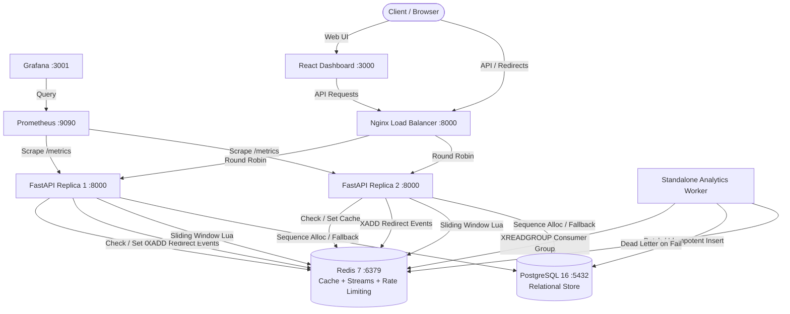
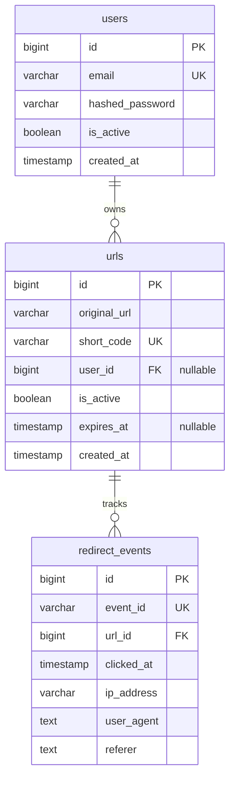

# System Architecture & Technical Specifications

This document outlines the distributed architecture, data flow patterns, caching strategies, failure domains, and scaling properties of the **Distributed URL Shortener & Analytics Platform**.

---

## 1. System Architecture Overview

The system decouples read-heavy redirect traffic from write-heavy analytical event processing and background persistence.

---

## 2. Core Subsystems

### 2.1 ID Generation & Base62 Encoding
- **Sequence Allocation**: IDs are allocated via PostgreSQL native sequence `urls_id_seq` (`SELECT nextval('urls_id_seq')`). This guarantees 64-bit strictly increasing collision-free integer IDs across distributed API replicas without inter-node coordination locks.
- **Bijective Base62 Mapping**: The integer ID is transformed into an alphanumeric short code using the alphabet `[0-9A-Za-z]`.
  - ID `1` -> `"1"`
  - ID `62` -> `"10"`
  - ID `238,327` -> `"zzz"`
- **Opaque Codes**: Custom aliases and opaque short codes are indexed via a unique B-Tree constraint on `urls.short_code`.

### 2.2 Dual-Tier Caching & Fail-Safe Fallback
- **Cache-Aside Pattern**:
  1. Redirect request arrives at `GET /{short_code}`.
  2. API inspects Redis key `url_shortener:redirect:{short_code}`.
  3. **Cache Hit**: Returns HTTP 307 redirect immediately (sub-millisecond latency).
  4. **Cache Miss**: Fallback query to PostgreSQL `urls` table. If active and unexpired, stored into Redis with a 24-hour TTL (`EX 86400`).
- **Resilience**: If Redis is unreachable, timeouts or connection errors are caught gracefully; queries degrade safely to PostgreSQL without raising 500 errors to callers.

### 2.3 Asynchronous Analytics Pipeline & Redis Streams
Redirect latency is the critical path. Database writes for analytics never occur in the HTTP redirect loop.

1. **Publisher (`XADD`)**: Upon redirect, the API publishes an event to Redis Stream `url_shortener:redirect_events` with payload:
   - `event_id` (UUIDv4)
   - `url_id` (integer)
   - `timestamp` (ISO-8601 UTC)
   - `ip_address`, `user_agent`, `referer`
   - Bounded via `MAXLEN ~ 100,000` to prevent memory exhaustion under backpressure.
2. **Consumer Group (`XREADGROUP`)**: A dedicated worker (`analytics_worker.py`) belongs to consumer group `url_shortener:analytics_group`.
3. **Idempotency**: Persistence into PostgreSQL `redirect_events` uses `event_id` unique constraint. Re-delivered messages are deduplicated cleanly.
4. **Dead-Letter Queue (DLQ)**:
   - If message parsing fails (poison pill) or database writes fail after bounded retries (default: 3), the worker moves the message to `url_shortener:redirect_events:dlq` and acknowledges (`XACK`) the primary stream to maintain consumer progress.

### 2.4 Distributed Rate Limiting
- Built on an atomic **Redis Sliding-Window Log** executed via an in-memory Lua script (`rate_limit.py`).
- Protects endpoints by IP address and route tier:
  - **URL Creation**: 20 requests per 60-second sliding window.
  - **Redirect Lookups**: 100 requests per 60-second sliding window.
- Returns HTTP 429 with standard headers: `Retry-After`, `X-RateLimit-Limit`, `X-RateLimit-Remaining`.
- **Fail-Open Availability Trade-off**:
  - If Redis is unreachable or raises a connection error, the rate limiter fails open (`allowed=True`).
  - *Architectural Rationale*: High availability of the core redirect and link creation paths is prioritized over strict throttling during cache/Redis infrastructure degradation.
  - *Security Trade-off*: Rate limiting is not enforced during a Redis outage; abusive traffic is not throttled until Redis connectivity is restored.

### 2.5 Security & Authentication
- **Password Hashing**: Direct `bcrypt` with salt generation.
- **Stateless Tokens**: PyJWT tokens signed with HS256 algorithm and configurable expiration.
- **URL Ownership**: URLs feature an optional `user_id` foreign key. Anonymous URL creation remains supported. Authenticated users can list and inspect analytics for their links.

---

## 3. Database Schema

---

## 4. Observability Matrix

| Metric Name | Type | Description |
|---|---|---|
| `url_shortener_http_requests_total` | Counter | Total HTTP requests by method, path, and status code. |
| `url_shortener_url_creations_total` | Counter | Number of short URLs successfully created. |
| `url_shortener_redirects_total` | Counter | Total short URL redirects served. |
| `url_shortener_cache_hits_total` | Counter | Number of redirects resolved directly from Redis cache. |
| `url_shortener_cache_misses_total` | Counter | Number of redirects requiring database lookup. |
| `url_shortener_analytics_published_total` | Counter | Redirect events published to Redis Streams. |
| `url_shortener_worker_processed_total` | Counter | Events successfully written to PostgreSQL by the worker. |
| `url_shortener_worker_dead_lettered_total` | Counter | Malformed or repeatedly failing events moved to DLQ. |
